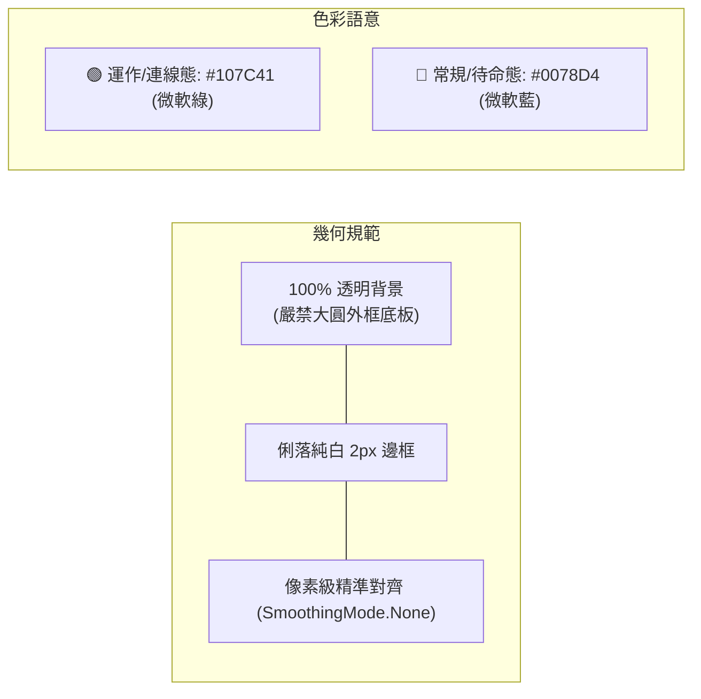

# 📐 小工具設計與互動規範 (Tools Design & Interaction Specification)

本文件定義本工坊旗下所有 Windows 桌面工具、托盤小工具與切換器的標準架構、UI/UX 互動標準、圖示設計規範與 IPC 效能準則。

---

## 🚀 1. 極速 OSD 懸浮即時通知規範 (Zero-Lag OSD HUD)

### 📌 背景與痛點解決
Windows 內建通知中心（Action Center / BalloonTip）具備強制 FIFO 排隊佇列與 0.5s 滑入動畫，當使用者快速連點捷徑時會造成嚴重的「通知大塞車與延後跳出過期通知」。
所有切換型小工具**一律採用獨立的極速 OSD (On-Screen Display) 懸浮即時卡片**。

### 🛠️ 技術實作標準
1. **無焦點最上層視窗 (Non-Stealing TopMost)**：
   * 必須配置 `CreateParams`：
     * `WS_EX_TOOLWINDOW (0x80)`：不顯示於工作列與 Alt+Tab。
     * `WS_EX_NOACTIVATE (0x08000000)`：絕對不搶走使用者當前操作視窗的焦點。
     * `WS_EX_TOPMOST (0x08)`：保持在螢幕最頂層。
   * 呼叫 Win32 `ShowWindow(hWnd, SW_SHOWNOACTIVATE)` 顯示。
2. **原地 0ms 即時翻轉 (In-Place Flip & Zero-Lag Render)**：
   * 連續點擊時，**禁止產生多個視窗實體或排隊**。
   * 呼叫 Win32 `SetWindowPos(HWND_TOPMOST, SWP_NOACTIVATE | SWP_SHOWWINDOW)` 搭配 `Invalidate()` + `Update()`，強制在當前畫面影格瞬間繪製（延遲 < 1ms）。
3. **底層精準定時器 (ThreadPool Timer)**：
   * 必須使用 `System.Threading.Timer` 進行 1.8 秒精準倒數。
   * 嚴禁單純依賴 WinForms `System.Windows.Forms.Timer`（避免因訊息循環延遲或無主視窗導致無法觸發）。
   * 時間到期透過 `ShowWindow(hWnd, SW_HIDE)` 俐落隱藏。
4. **字體排版與無 Emoji 缺字原則**：
   * 標題採用 `Microsoft JhengHei UI (11.5pt Bold)`，副標採用 `Microsoft JhengHei UI (9pt Regular)`。
   * **嚴禁在 GDI+ DrawString 字串中直接包含 Emoji（如 🖥️, 💻, 🌐）**，避免微軟正黑體缺字產生豆腐塊方框 `▯`。圖示統一由左側 48x48 向量/像素級 Icon 呈現。
5. **支援點擊手動關閉**：
   * 滑鼠點擊 OSD 卡片本體時，必須立即關閉視窗。

---

## 🎨 2. 預設圖示設計規範 (Default Icon Specification)

當建立新工具且使用者未特別指定客製化風格時，**預設一律套用微軟 Fluent 極簡幾何標準**：

1. **幾何邊界**：
   * 採用 2~3px 俐落純白線條主體（螢幕、底座、天線、主機）。
   * **背景 100% 透明**，嚴禁在 32x32 尺寸繪製大圓底板（杜絕低解析度鋸齒與毛邊）。
   * 像素精準對齊：繪圖時設定 `SmoothingMode.None`，確保直線完全咬合在像素格點上。
2. **色彩語意**：
   * 🟢 **運作 / 連線態 (Active)**：`#107C41`（微軟綠 / Office綠）
   * 🔵 **常規 / 待命態 (Normal)**：`#0078D4`（微軟藍 / Windows藍）
   * 🟡 **警告 / 暫停態 (Warning)**：`#F7630C`（琥珀橘）

---

## 🏷️ 3. 桌面捷徑說明與懸停規範 (Shortcut Tooltip Standard)

所有桌面捷徑（`.lnk` 檔案）必須主動配置 `Description`（註解）屬性，提供乾淨、一致的功能說明，避免顯示冗長硬碟路徑。

$$\text{標準模板：} \quad \text{【工具名稱】 - 【核心功能一句話】 (雙擊快速切換)}$$

### 範例：
* 🖥️ **螢幕切換**（範例）：`螢幕切換 - 筆電/外接螢幕雙模切換 (雙擊快速切換)`

---

## ⚡ 4. 極速單一實例與非同步 IPC 架構規範 (Zero-Lag Architecture)

為保證桌面雙擊捷徑切換時達到極致 0 延遲：
1. **次要行程極速信號**：次要行程在 `Main()` 第一行直接透過全域 `Mutex` 判定，若非首個實例，立即透過 `EventWaitHandle.Set()` 喚醒主行程並直接退出（耗時 < 2ms）。
2. **UI 執行緒精準派發**：主行程使用 `SynchronizationContext.Current.Post` 派發切換請求，嚴禁依賴未建立 HWND 的 `ContextMenuStrip.BeginInvoke`。
3. **磁碟與 COM I/O 100% 移入背景**：`UpdateDesktopShortcutIcon`、`shortcut.Save()`、`SHChangeNotify` 及 `powercfg` 一律移入 `ThreadPool` 背景異步執行，UI 執行緒僅專注於 0ms 瞬間完成 OSD 卡片與托盤圖示渲染。
4. **防抖門檻精準化**：點擊門檻設為 15ms，確保連擊不會被誤殺遺漏。

---

## 📜 變更紀錄

| 版本 | 日期 | 變更 | 需跟進的工具 |
| :-: | :-: | :--- | :--- |
| v1 | 範本初版 | 建立：Zero-Lag OSD 懸浮通知、Fluent 極簡圖示、捷徑說明、單一實例 IPC 架構 | — |
